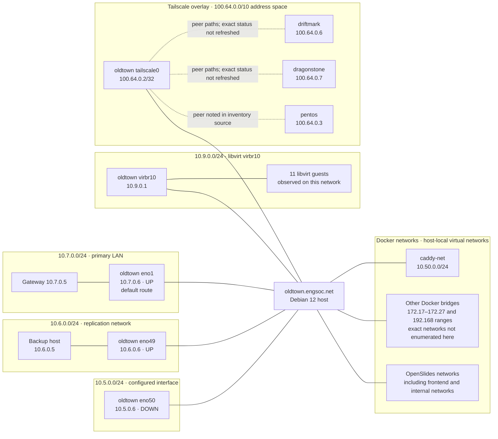
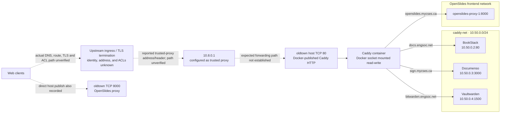

# `oldtown` network map

**Snapshot basis:** Runbook observations dated 13 October 2026, plus configuration details recorded in the accompanying inventory. This is a logical map, not a verified physical cabling or firewall diagram. The current execution shell cannot query the host's live network namespace, so addresses, routes, and listeners below have not been refreshed.

## Logical topology

The diagram places the recorded interfaces and networks; it does not assert that every segment is physically adjacent or that the shown paths are currently reachable. In particular, `virbr10` was described as a bridge-forwarding network, not a typical libvirt NAT network. Confirm its upstream Layer 2 connection before drawing a physical topology.

## Web ingress and application routing

The inventory reported no host TCP 443 listener and Caddy automatic HTTPS disabled. The upstream TLS endpoint and whether it is actually `10.8.0.1` are unknown; `10.8.0.1` is recorded as a trusted proxy configuration, not verified as the public ingress device. Caddy's custom client-IP header is `X-Engsoc-Ingress-Ip`; only trusted infrastructure should be able to set it.

## Interfaces and routes recorded

| Interface | Recorded address/state | Purpose or evidence |
|---|---|---|
| `eno1` | `10.7.0.6/24`, UP | Default route via `10.7.0.5` |
| `eno49` | `10.6.0.6/24`, UP | Same-subnet path to replication target `10.6.0.5`; inventory reported TCP/22 reachable |
| `eno50` | `10.5.0.6/24`, DOWN | Configured address; purpose unknown |
| `virbr10` | `10.9.0.1/24`, UP | Libvirt guest bridge; bridge forwarding reported |
| `tailscale0` | `100.64.0.2/32` plus IPv6 | Tailscale overlay |
| Docker bridges | Several | Includes `caddy-net` at `10.50.0.0/24`; additional ranges recorded as `172.17–172.27` and `192.168.*` |

Recorded Tailscale peers include `driftmark.engsoc.net` (`100.64.0.6`) and `dragonstone.engsoc.net` (`100.64.0.7`). The underlying physical route, peer connectivity, and subnet-route advertisements were not captured here. A second inventory source also lists `pentos.engsoc.net` (`100.64.0.3`); confirm that peer is still relevant.

## Host services with network significance

These are reported socket binds, **not a statement that each port is reachable from the Internet**. Effective host rules and upstream ACLs were not available for this refresh.

| Port | Recorded bind | Service / note |
|---|---|---|
| TCP 22 | IPv4 and IPv6 wildcard | SSH administration |
| TCP 80 | IPv4 and IPv6 wildcard | Docker-published Caddy HTTP ingress |
| TCP 8000 | IPv4 wildcard | OpenSlides proxy; also reported directly published |
| TCP 445, 139 | IPv4 and IPv6 wildcard | Samba SMB / NetBIOS session service |
| UDP 137, 138 | Multiple interfaces | Samba NetBIOS name and datagram service |
| TCP/UDP 111; TCP 2049; dynamic RPC ports | Wildcard or broad binds | rpcbind, NFS and related RPC; inventory reported no configured exports |
| TCP 9090 | Wildcard | Cockpit, socket-activated; custom firewall rule reportedly restricts source to `10.8.0.0/16` |
| TCP 5002 | IPv4 wildcard | Houston alert webhook |
| TCP/UDP 5355 | IPv4 and IPv6 wildcard | LLMNR via systemd-resolved |
| TCP 25, 53 | Loopback | Postfix SMTP and systemd-resolved stub |
| TCP 5900, 5901 | Loopback | QEMU VNC |
| TCP 9002 | Loopback | OpenSlides backendManage |
| TCP 42780 | Loopback | Redis, as identified in the inventory |

## Firewall and trust boundaries

- The inventory says UFW is enabled but inactive, while `nftables.service` is disabled and live rules are installed or changed by Tailscale, Docker, libvirt, and `/root/firewall.sh`.
- `/root/firewall.sh` reportedly sets forwarding and NAT behavior and a `FORWARD` default drop policy, but does not set `INPUT` to drop. This is not enough to infer which inbound services are reachable.
- The source ACLs, VLANs, switch ports, router/firewall devices, public DNS records, NAT mappings, and TLS termination point are not known from the available evidence.
- The replication destination `10.6.0.5` is on the same recorded `/24` as `eno49`; routing to it does not establish that the current SSH replication succeeds. The latest readable logs instead show the configured SSH identity is missing and authentication fails.

## What to verify to turn this into an authoritative map

1. Capture `ip -br address`, `ip route`, `ip -6 route`, and `ip rule show` on the host.
2. Capture `bridge link`, `bridge vlan show`, `virsh net-dumpxml virbr10`, and `docker network inspect` for each network.
3. Capture `ss -lntup`, `nft list ruleset`, `iptables-save`, and `ip6tables-save` together, with timestamps.
4. Ask the network operator for VLAN/subnet ownership, upstream ACLs, public DNS, ingress/TLS termination, and whether `10.8.0.1` is the sole trusted proxy.
5. Verify Tailscale peer state and advertised routes; confirm whether `pentos` belongs on this map.
6. From an authorized external vantage point, validate which published services are actually reachable. Socket binds alone do not establish exposure.

Do not use `/root/firewall-testing.sh` for discovery; the inventory describes it as flushing firewall/NAT rules and changing routing.
