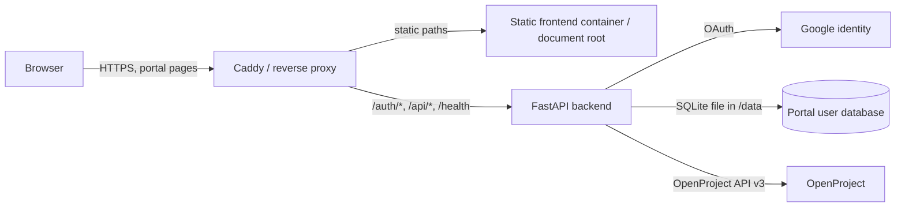

# Application Architecture

**Reviewed:** 2026-10-13  
**Evidence:** Repository-defined configuration and documentation in `/home/bekkers/working/tasks.mycses.ca/` and `/home/bekkers/working/tasks-site-deploy/`. These files do not establish which checkout, Compose project, image, or configuration is active on `pentos.engsoc.net`.

## CSES Affiliates Portal

The checked-in design consists of a static frontend, a FastAPI backend, a SQLite user database, Google OAuth, and an OpenProject API integration. The browser receives the portal session cookie; the OpenProject API key is configured server-side in the backend environment.

The backend Compose manifest builds from `backend/`, consumes `/opt/tasks-portal/secrets/backend.env`, persists `/opt/tasks-portal/data` at `/data`, and publishes container port 8000 on host loopback port 8001. It joins an external Docker network named `caddy-net`; Caddy routing is expressed through container labels. The manifest does not define the external network or the Caddy service, so those dependencies must be inspected on the host.

Repository documentation says Caddy sends `/auth/*`, `/api/*`, and `/health` to FastAPI and serves other paths as static content. The older OpenProject override expresses separate Caddy handlers for `/openproject/*` and `/*`; whether those labels are active depends on the deployed Compose files and Caddy configuration. The legacy OpenProject manifest separately defines a proxy service and a `PORT` mapping whose default is host port 8080.

### Repository discrepancy to resolve

The portal README names `/var/www/tasks.mycses.ca` as the static deployment destination. The retained root `docker-compose.override.yml` mounts `/var/www/tasks` into its `landing` Nginx service. In addition, the backend Compose file and OpenProject override are separate manifests, and neither proves that the matching frontend is deployed. Determine the active deployment checkout, deploy script, Compose project/files, static document root, and Caddy routes before making deployment changes. Record the confirmed values and source here.

### Request and administration flow

1. A user opens the static portal and signs in through Google OAuth endpoints on FastAPI.
2. FastAPI requires a verified email in the configured allowed-domain set. Administrator status is based on the configured administrator email list and persisted account role; account records are stored in SQLite.
3. An authenticated request is submitted to `POST /api/requests`. The backend adds the authenticated user's identity and creates an OpenProject work package using its server-side API key.
4. Administrator endpoints list open work packages and update fields such as subject, description, status, priority, and assignee. The backend enforces administrator authorization; hiding admin UI alone is not the access control.

The repository configures an eight-hour, HTTPS-only, same-site `lax` session cookie. `/health` reports application process health; the code does not make it a dependency/readiness check for SQLite, Google, or OpenProject. Verify the monitoring system's expectations before using it as a full service health signal.

## OpenProject stack

The root `docker-compose.yml` describes an OpenProject deployment with web, worker, cron, seeder, PostgreSQL, memcached, proxy, autoheal, and Hocuspocus collaboration services. PostgreSQL and application assets use Compose-managed volumes by default. A separate control manifest defines backup and PostgreSQL upgrade jobs; those jobs mount a repository-relative `./backups` directory. Exact volume names depend on Compose project naming and overrides.

The Compose file includes fallback credentials and collaboration secrets such as `p4ssw0rd`, `OVERWRITE_ME`, and `OVERRIDE_ME_PLEASE`. These defaults are unsafe for deployment. The live environment must explicitly replace them; a repository setting does not show whether the live stack uses the fallback. The default database image is PostgreSQL 13, while repository control notes describe an upgrade path to PostgreSQL 17. Confirm the actual database version and supported migration path before upgrades.

The portal API and OpenProject web application are distinct components. The checked-in integration flow uses the portal backend to call OpenProject API v3; it does not imply that OpenProject's internal database is the same as the host-level PostgreSQL service listed in the system snapshot.

## Trust boundaries and data stores

| Boundary / store | Repository evidence | Live verification needed |
| --- | --- | --- |
| Public HTTPS edge | Caddy labels describe host routing | Active proxy, TLS config, DNS, firewall, upstream ACLs |
| Portal backend | Loopback port mapping and external `caddy-net` attachment | Active container, env-file presence, image/build revision, network membership |
| Portal identity data | SQLite path `/data/portal.db`; host path `/opt/tasks-portal/data` in backend Compose | Backup schedule, access controls, actual mount and restore evidence |
| OpenProject data | Compose named volumes for PostgreSQL and assets | Actual volume names, backup destination, retention, encryption, restore tests |
| Credentials | Backend environment file path and Compose placeholders | Secret manager/source of truth, permissions, rotation status; do not copy values into docs |

## Operational dependencies

The documented portal workflows depend on outbound reachability to Google identity endpoints and the configured OpenProject API URL. Caddy must reach the backend and static content. The backend's local health route is not evidence that these integrations work. The repository does not define service-level objectives, recovery time/point objectives, owners, or a complete restore runbook; obtain these from service owners before representing them as established controls.
